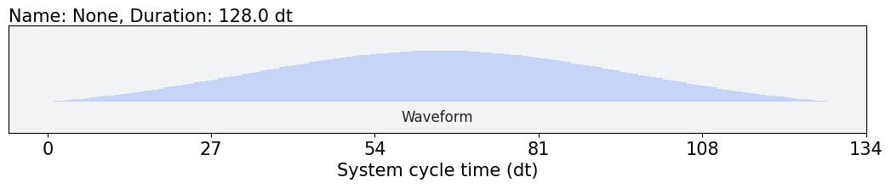
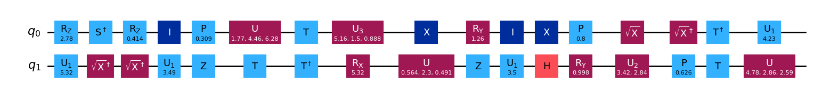
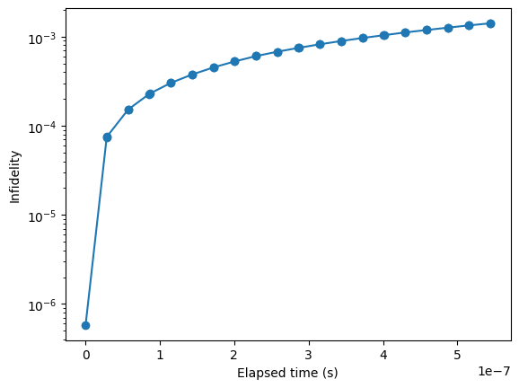
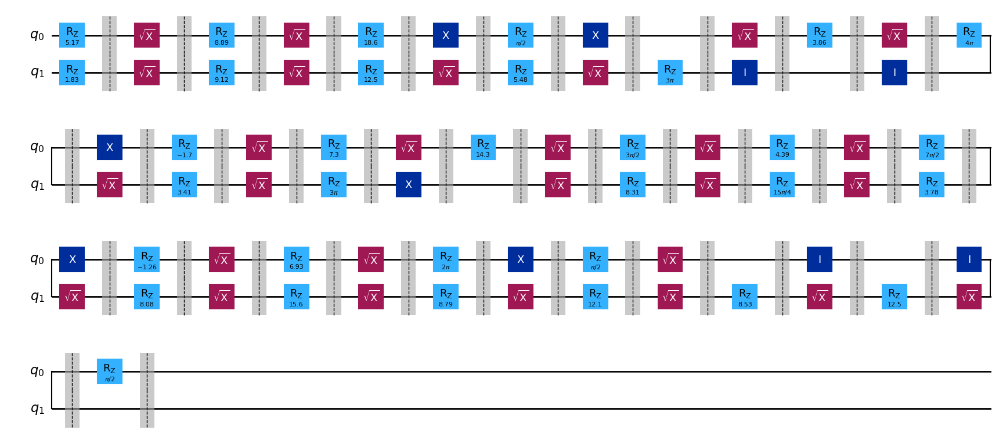

# Pulse Simulator

This project simulates quantum circuits using custom pulse schedules.

## Installation

The package is managed by [Poetry](https://python-poetry.org/). JAX GPU features are installed by default, but a CPU version can be used instead.

## Basic usage

We use *Qiskit* for our circuits, and *Qiskit Dynamics* for our pulses. 
This means that--under the hood--we are using *JAX* for the linear algebra.

```Python
import pulse_simulator as ps

import numpy as np
import matplotlib.pyplot as plt
import jax

# qiskit
from qiskit.providers.fake_provider import GenericBackendV2
from qiskit.quantum_info import process_fidelity
import qiskit_dynamics

# jax stuff
jax.config.update("jax_enable_x64", True)
qiskit_dynamics.array.Array.set_default_backend("jax")

# Check if GPU is available
print("jax backend: ", jax.default_backend())
```

Make a fake **backend**.
```Python
num_qubits = 10

# Basis gates
basis_gates = ["id", "rz", "sx", "x", "ecr"]

# Linear connectivity (with 2QB gates in both directions)
coupling_map = (
    [[i, i + 1] for i in range(num_qubits - 1)] 
    + [[i + 1, i] for i in range(num_qubits - 1)]
)

backend = GenericBackendV2(
    num_qubits=num_qubits, 
    basis_gates=basis_gates,
    coupling_map=coupling_map,
)

# Select subset of registers to simulate
registers = [0, 1]
```

We need to define pulses that implement a gate set.
```Python
ns = 1e-9
dt_simulation =  backend.dt / ns
desired_1qb_samples = 120
duration_1qb = ps.qiskit_closest_multiple_of_16(desired_1qb_samples)

default_1qb_gateset = ps.default_single_qubit_gateset(
    ["X1", "X2", "SX1", "SX2", "ID1", "ID2"], duration_1qb, dt_simulation
)

default_1qb_gateset["X1"].draw()
```


We need a circuit to simulate.
```Python
from qiskit.circuit.random import random_circuit

depth = 4
seed = 17
# This circuit will only use 1QB gates
rand_circ = random_circuit(len(registers), seed, max_operands=1)
```


Now we can run the simulation:
```Python
# Build the pulse simulator
simulator = ps.Simulator(registers, backend)

# Add some errors to make it interesting!
res = simulator.simulate_circuit(
    rand_circ, 
    default_1qb_gateset, 
    None, # default 2QB gateset
    dt_simulation, 
    include_crosstalk=True, 
    include_dissipation=True,
    gpu=True,
)

# Let's check in on the simulation after each gate
moments = simulator.get_moments()
measure_times = np.cumsum(
    ps.durations_of_moments(moments, duration_1qb, 0.0)
) * backend.dt

# These were the expected outcomes
U_goals = [] 
for i in range(len(moments)):
    U_goals.append(ps.build_operator(moments[0:i+1], registers))

# How did we do?
fidelities = np.array([process_fidelity(R, U) for R, U in zip(res[1:], U_goals)])

# Plot the result
fig, ax = plt.subplots(1)
ax.plot(measure_times, 1 - fidelities, marker="o")
ax.set_xlabel("Elapsed time (s)")
ax.set_ylabel("Infidelity")
ax.set_yscale("log")
```


## Helpful notes
The simulator blocks circuits into one or two qubit moments. We can visualize this:
```Python
simulator.build_circuit(insert_barriers=True).draw('mpl')
```


You can also extract the pulse schedule or the individual moments (in fact, we previuously 
used the moments to find the measurement times in the example).
